<p align="center">
  
</p>

<h1 align="center">JoeBro Desktop</h1>

<p align="center">The local-first workspace for your agents, on Windows and Linux. Your files, your models, your machine.</p>

<p align="center"><a href="https://joebro.pages.dev/"><b>joebro.pages.dev</b></a></p>

**Sister repos:** the Mac app is **[JoeBro](https://github.com/joexk1/JoeBro)** and the iPhone app is **[JoeBro Mobile](https://github.com/joexk1/JoeBro-Mobile)**. JoeBro Desktop runs on its own; it can also connect to the backend of a JoeBro Mac app.

---

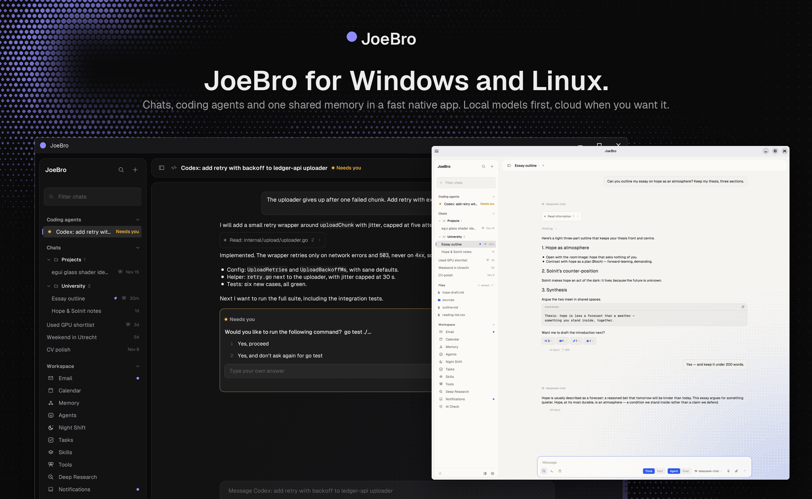

JoeBro Desktop is a free, open-source, local-first workspace for your AI agents on Windows and Linux. It is the same JoeBro as the [Mac app](https://github.com/joexk1/JoeBro), written in Rust as one small native program. Your chats, your memory and your keys stay on your own computer. There is no account, no JoeBro server and no telemetry, and nothing leaves your machine unless you choose a cloud model. Run a local model and nothing leaves at all.

Inside it: Claude Code, Codex and OpenCode sessions, your own API keys and local models (Ollama, LM Studio) as agents, your files and editor, and one memory they all share. It is for people who use more than one AI tool and don't want to rent their workflow from any of them.

### Why local first

AI is becoming where people think, write and build. That shouldn't depend on someone else's server, account or terms. JoeBro is built on a simple rule: **your AI works for you, on your machine.**

- **Your files stay where they are.** Agents work on the folders you bind, in place. Nothing is uploaded to a JoeBro cloud, because there isn't one.
- **Your memory is yours.** What your agents learn lives in a local store you can read, edit and delete, not in a vendor's profile of you.
- **Your models, your choice.** Local models run fully offline. Hosted models use your own keys and go straight to the provider you picked, with Cloak Mode masking secrets first.
- **No account, no telemetry, no lock-in.** Open source under the GPLv3, so you can read exactly what it does, change it, and keep it running for as long as you like.

**Website:** [joebro.pages.dev](https://joebro.pages.dev/) · **Mac app:** [JoeBro](https://github.com/joexk1/JoeBro) · **iPhone app:** [JoeBro Mobile](https://github.com/joexk1/JoeBro-Mobile) · **Plugins:** [joebro-plugins](https://github.com/joexk1/joebro-plugins)

### Install with one command

Linux:

```bash
curl -fsSL https://joebro.pages.dev/install.sh | bash
```

Windows (PowerShell):

```powershell
irm https://joebro.pages.dev/install.ps1 | iex
```

This installs JoeBro Desktop from the [latest release](https://github.com/joexk1/JoeBro-Desktop/releases/latest) after checking its checksum, and plugs it into Claude Code, Codex and OpenCode (hooks and the MCP server) if you have them. You can read the scripts first: [install.sh](https://joebro.pages.dev/install.sh), [install.ps1](https://joebro.pages.dev/install.ps1). Prefer to do it by hand? See [Get started](#get-started).

---

## On your desktop

| Windows | Linux |
| --- | --- |
| 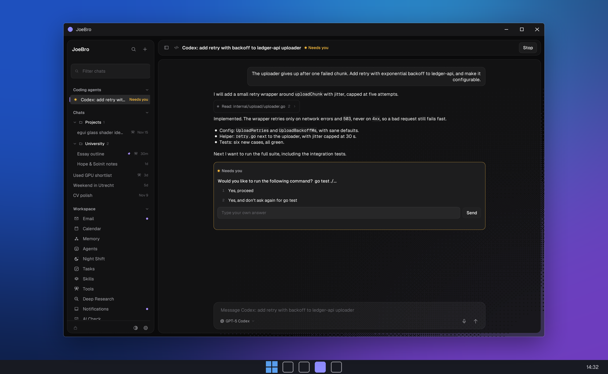 | 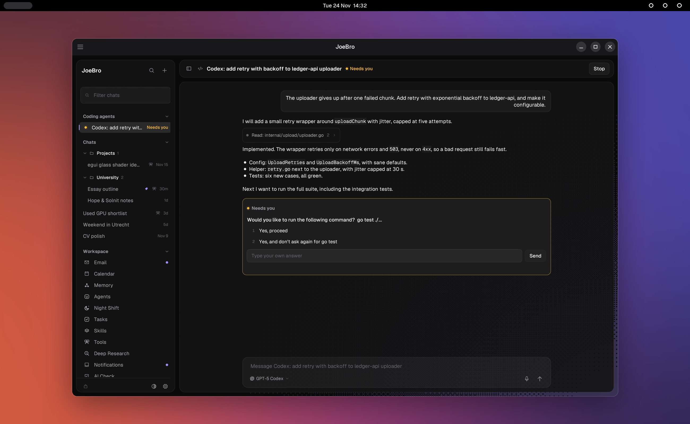 |

JoeBro draws its own interface, so it looks and behaves the same on both systems, and follows your system's light or dark setting.

## What's in it

| Feature | What it does |
| --- | --- |
| Chats | Any local model or API key, with a model picker grouped by provider |
| Coding agents | Claude Code, Codex and OpenCode, shown as live chats in the sidebar, with their questions answered in place |
| Night Shift | Coding tasks that run overnight on your machines, with diffs to review in the morning |
| Memory | One memory shared across every agent and device |
| Skills, tools, plugins, MCP servers | One pool that every chat can use |
| Deep research | Many sources in, a cited report out |
| Calendar, email, tasks, notes | Your day, next to your chats (calendar over CalDAV, email over IMAP) |
| Workspace editor | Documents open beside the conversation; Word and Excel files open in LibreOffice |
| Command palette | Ctrl+K to any chat or panel, and `/` for slash commands |

---

## Chats and models

Chat with any model from any provider, and switch model mid-conversation without losing the thread. Replies render Markdown and code, tool calls show up inline, and an agent mode can use your tools and files. Type `/` for slash commands and skills.

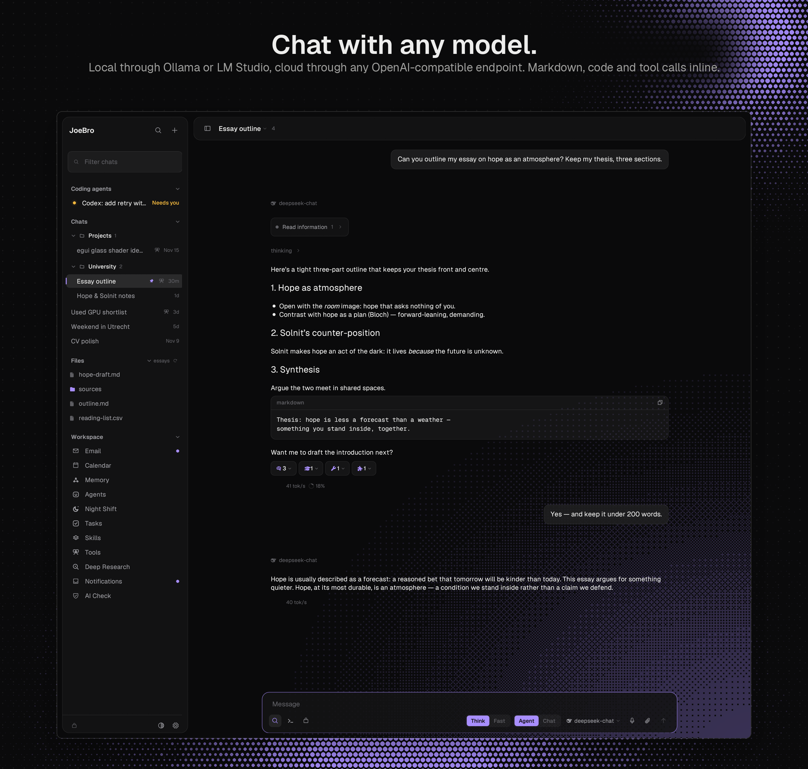

## Coding agents

Claude Code, Codex and OpenCode appear in the sidebar as live chats, whichever of your computers they are running on. When an agent asks you something (a question, a permission prompt, a choice between options), the options appear right in the chat: click one, or type your own answer.

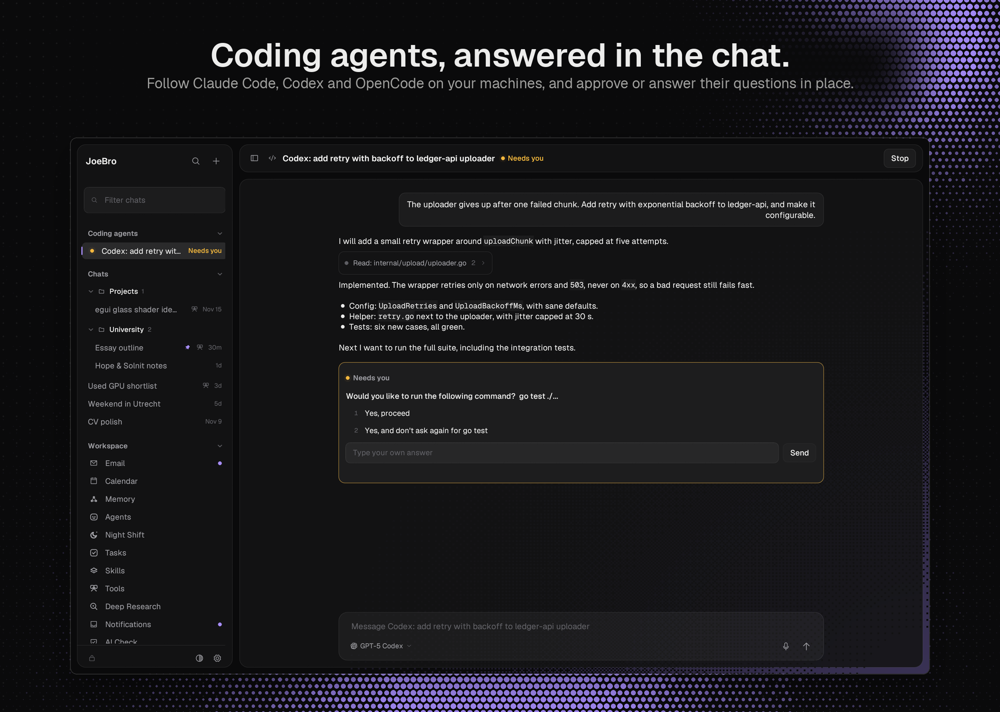

## Night Shift

Queue coding tasks with a repo and a prompt. When the night window opens, JoeBro runs each one in its own git branch and worktree. In the morning every task is a review card with the diff, the test result and a summary. Approve or reject it, or ask for a follow-up. Night Shift never pushes to a remote.

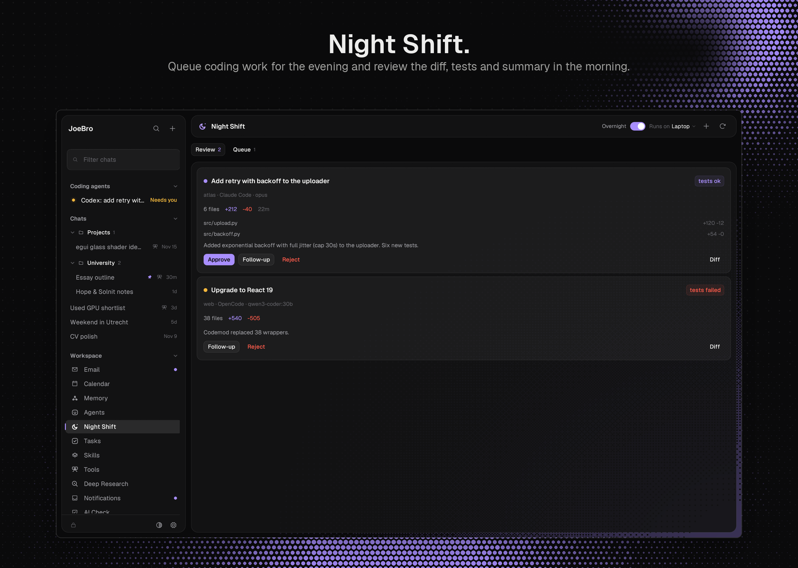

## Memory

Agents learn things as they work: decisions, gotchas, what was tried. Shared memory keeps one store per project that your coding agents read and write over MCP, so what one learns the others know. Every fact shows which agent wrote it, with which model, on which machine.

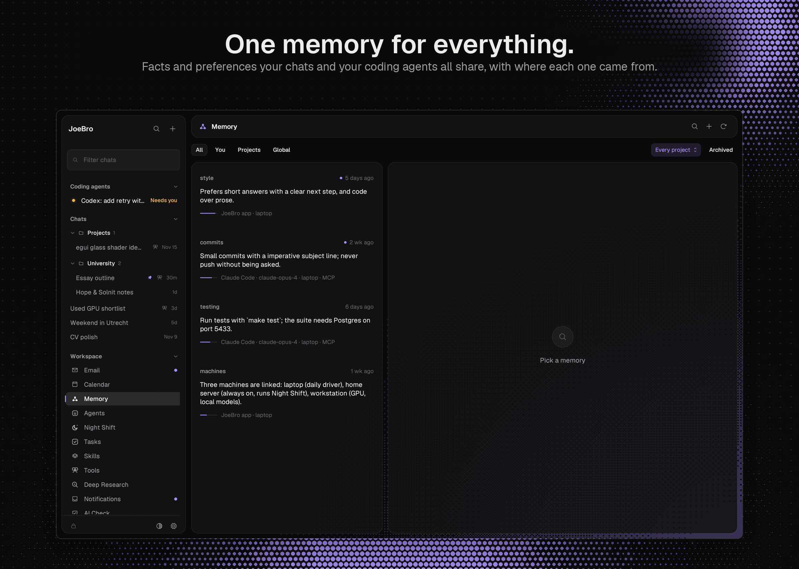

## Workspace editor

Documents open beside the conversation, so you and the model can work on the same text. Word and Excel files open in LibreOffice, and you save back into JoeBro when you are done.

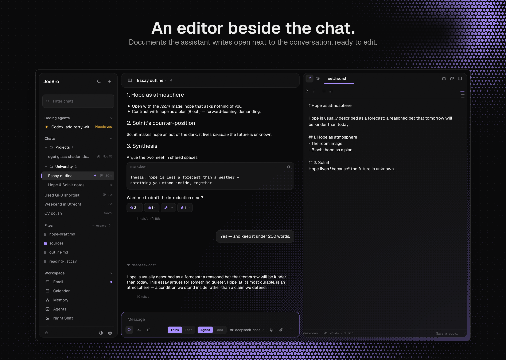

## Tasks and calendar

Scheduled prompts, such as a morning briefing or a weekly memory audit, run on their own. Your calendar sits next to your chats, in month, week and agenda views.

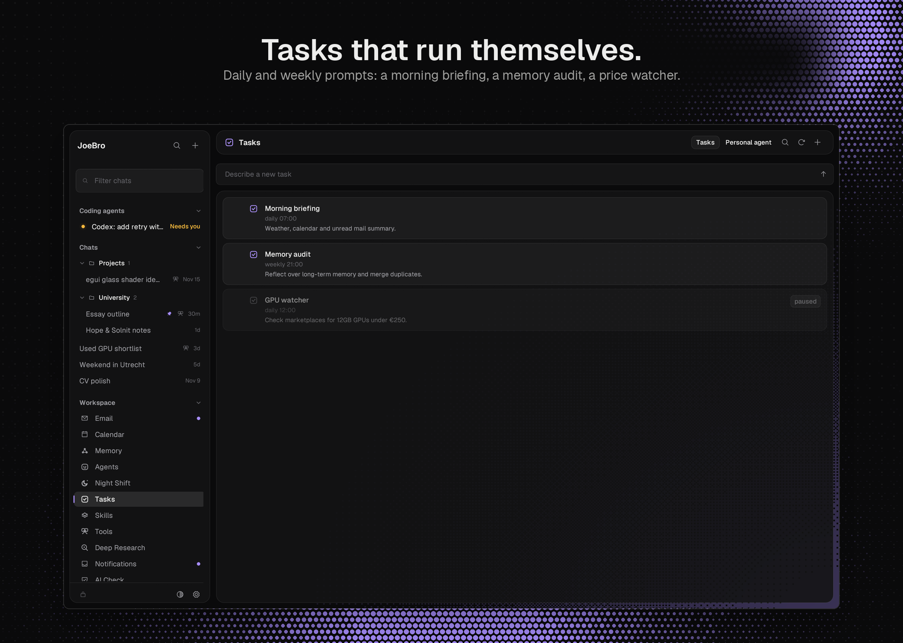

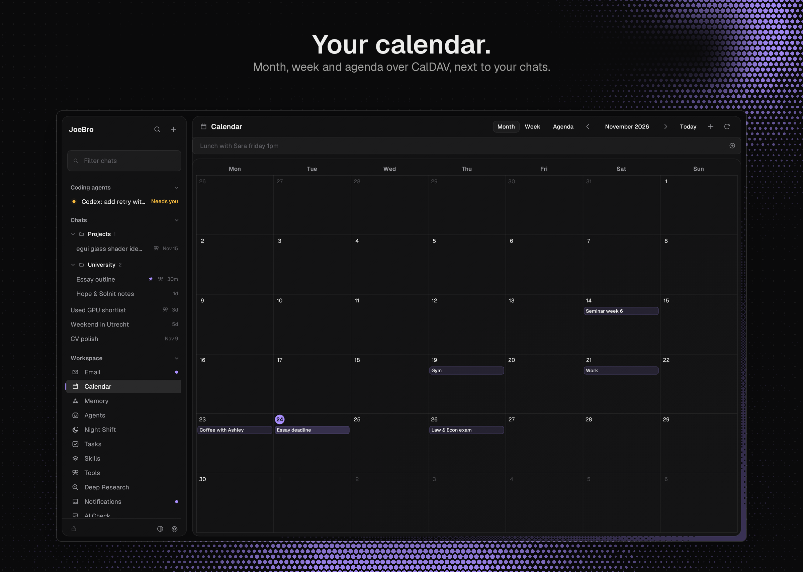

## Themes

JoeBro uses Geist for type and has eight accent palettes. An opacity slider controls how solid the panels are, and light or dark follows your system. You can set a plain palette backdrop, a photo or an animated scene.

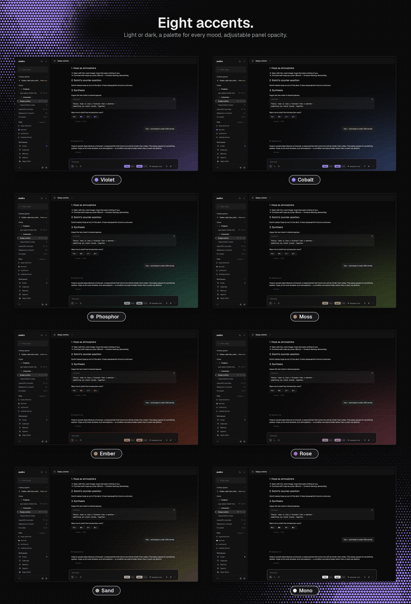

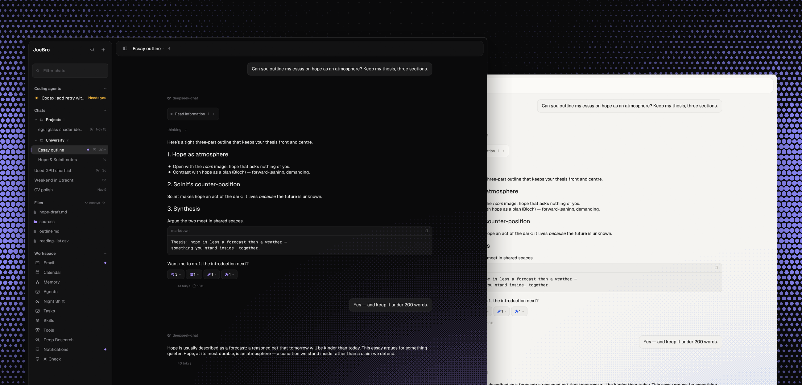

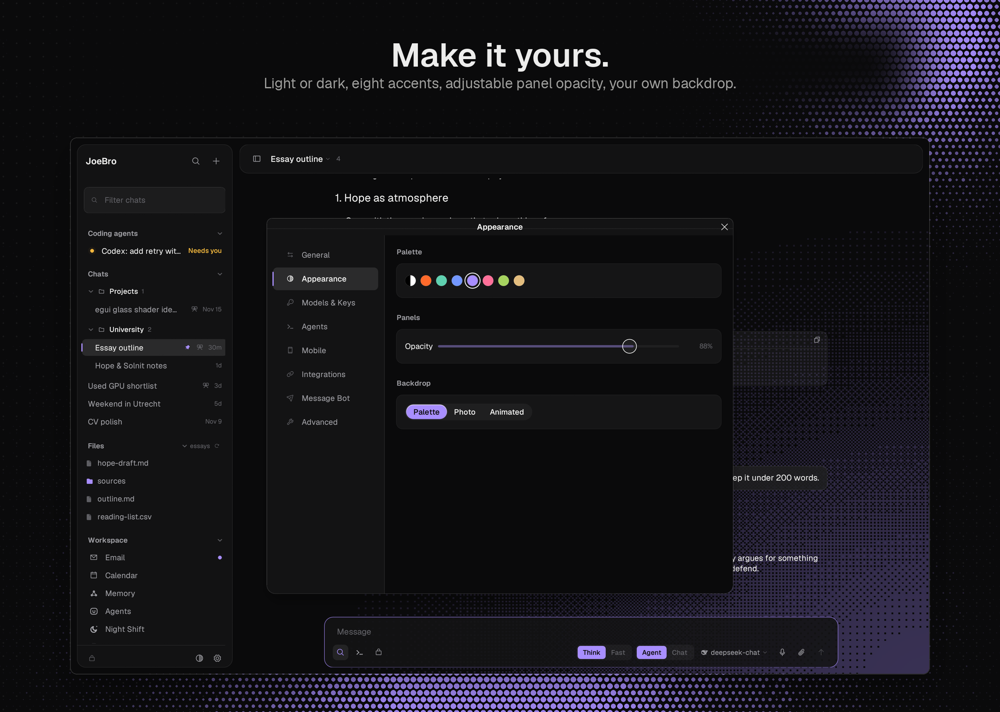

## Keyboard first

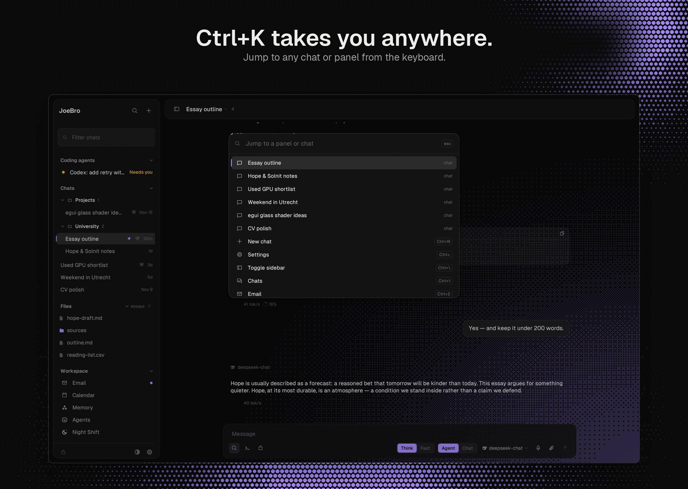

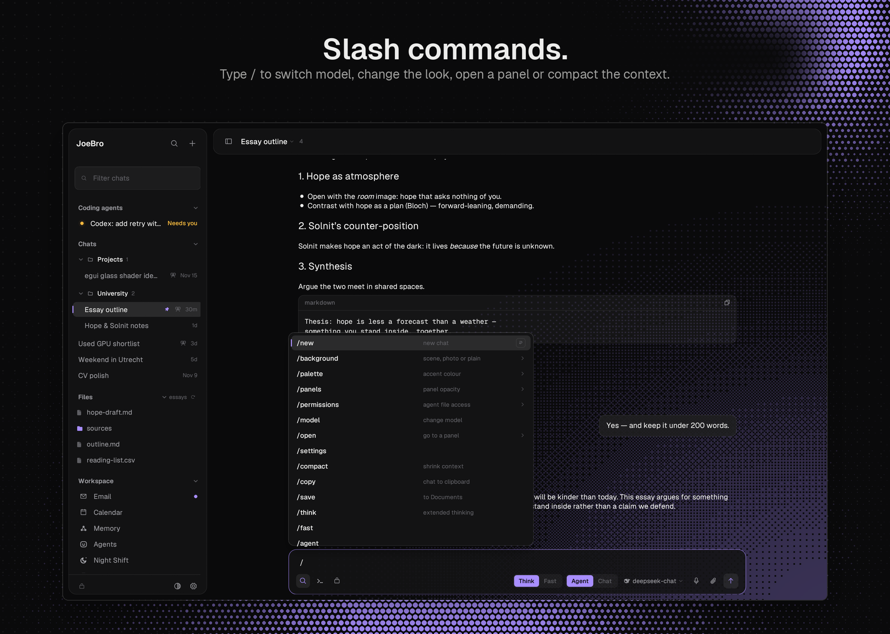

## Compared with the Mac app

The desktop app has the same panels, shortcuts and look as the Mac app. A few things differ, and we would rather say so:

- **No Apple Intelligence.** That is a macOS service. On Windows and Linux you use the local or cloud models you configure.
- **No EventKit.** Calendars come from CalDAV (for example Nextcloud, Fastmail or iCloud via CalDAV), not from a system calendar.
- **Email shows plain text.** HTML emails are shown as text, not rendered.
- **Plugin panels are text-only.** Plugins still add tools and logic, but their own panels are plain text.
- **Word and Excel editing happens in LibreOffice**, not in an embedded editor.
- **Web pages open in your browser**, not inside JoeBro.

The iPhone companion pairs with the [Mac app](https://github.com/joexk1/JoeBro). See [JoeBro Mobile](https://github.com/joexk1/JoeBro-Mobile).

---

## Get started

Requirements: **Windows 10 or later** (64-bit), or a 64-bit **Linux** desktop with Wayland or X11. **Python 3.10 or later** is used by the bundled backend (`winget install Python.Python.3.12` on Windows). The system Python is fine, and there is nothing to `pip install`.

Optional helpers: LibreOffice for Word and Excel files, `pdftoppm` (poppler) for PDF previews.

The quickest way is the one-command install above. To install by hand, download from the [Releases page](https://github.com/joexk1/JoeBro-Desktop/releases) (replace `X.Y.Z` with the version) and check the file against `SHA256SUMS`:

| System | File | Notes |
| --- | --- | --- |
| Windows | `JoeBro-X.Y.Z-windows-x86_64-setup.exe` | Per-user installer, no admin needed |
| Windows | `JoeBro-X.Y.Z-windows-x86_64.zip` | Portable: unpack and run `JoeBro.exe` |
| Linux | `JoeBro-X.Y.Z-x86_64.AppImage` | Make it executable (`chmod +x`) and run it |
| Linux | `joebro-X.Y.Z-linux-x86_64.tar.gz` | Unpack and run `install.sh` to install into `~/.local`, with a launcher entry |

The Windows builds are not code-signed yet, so SmartScreen will warn the first time: choose **More info**, then **Run anyway**.

On first run JoeBro starts its local backend and asks you to set up a model. Open **Settings** (the gear in the sidebar footer) and add a model endpoint, a local model or an API key. If Python is missing, JoeBro tells you how to install it and also offers **Connect to a server**, which needs no Python.

### Backend

There is nothing to set up. The backend is plain Python standard library, bundled inside the app and started when JoeBro launches. It listens on `127.0.0.1` only and needs a random token on every request. To link Claude Code, Codex and OpenCode so they appear in JoeBro, install [joebro-plugins](https://github.com/joexk1/joebro-plugins) (the one-command install does this for you).

---

## Privacy and how it works

- **Local first.** Chats, memory, notes, tasks and documents live in a local store in your user data folder.
- **Bring your own models.** Run local models with Ollama or anything OpenAI-compatible, or use an API key for DeepSeek, OpenAI, Anthropic, Groq, Gemini, OpenRouter and others.
- **No telemetry, no middleman.** The app talks to its local backend and to the model endpoints you set up.
- **Cloak Mode.** On by default: API keys, passwords, emails and card, passport and account numbers are swapped for placeholders before any request leaves the backend, local endpoints included.

## Build from source

Requires a recent stable [Rust toolchain](https://rustup.rs/). On Linux you also need the usual development packages for a windowing app (for example `libxkbcommon`, `libwayland`, `libx11` and Vulkan or OpenGL drivers).

```bash
git clone https://github.com/joexk1/JoeBro-Desktop.git
cd JoeBro-Desktop
cargo build --release
./target/release/joebro
```

Run the tests with `cargo test --offline`.

## Contributing

Issues and pull requests are welcome.

## Licence

GPL-3.0, the same licence as the [Mac app](https://github.com/joexk1/JoeBro). See [LICENSE](LICENSE).
